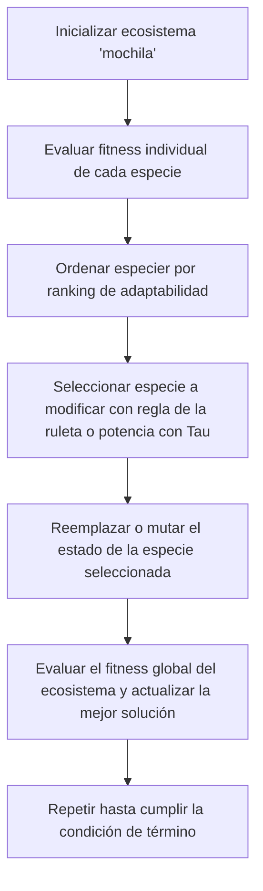

# Extremal-Optimization
Proyecto de algoritmos metaheurísticos
## Preproyecto
Se tiene un conjunto de N elementos, donde cada elemento 
$$
i \in (1, ..., N) 
$$
posee un peso $w_i > 0$, y un valor o beneficio
    $v_i > 0$, y una mochila con una capacidad máxima $C > 0$, se desea determinar qué elementos incluir en la mochila para:
- Maximizar el valor total de los elementos seleccionados 
$$
\sum_{i=1}^{N}(v_i*x_i)
$$
- Sujeto a la restricción de la capacidad  
    
$$ 
\sum_{i=1}^{N} (w_i*x_i) <= C
$$
- Donde $x_i \in {0,1}$ representa la inclusión $(x_i = 1)$ o exclusión $(x_i = 0)$ del elemento i.
### Forma de ejecución
El programa deberá ejecutarse desde la línea de comandos (CLI) indicando los parámetros requeridos. Por ejemplo:
```bash
python eo.py instancia_mochila.txt 1000 1.4 12345 resultados.csv
```
Estos parámetos son:
1. Archivo de entrada
2. Numero de iteraciones o condición de término
3. Valor de Tau
4. Semilla aleatoria
5. Archivo de entrada

### Salida
La salida será en un CSV estructurado de la siguiente manera:
1. Instancia evaluada
2. Semilla utilizada
3. Valor del parámetro Tau
4. Número de iteración
5. Valor total **(del beneficio)** de la mejor mochila encontrada
6. Peso total consumido por la mejor solución
7. Indicador de validez (cumple o excede la capacidad $C$ )
8. Tiempo total de ejecución (usando el módulo ```time``` )

### Organización del programa
- Se deben utilizar los siguientes archivos principales:

```bash
eo.py
operadores.py
``` 
En caso de ```eo.py``` deberá tener el siguiente flujo como principal para el algoritmo ```Extremal Optimization```



El archivo ```eo.py``` debe tener funciones implementadas en ```operadores.py```
Estas funciones son las siguientes:
```py
def inicializacion_ecosistema():
def eval_fitness_individual():
def seleccion_especie():
def reemplazo_especie(): # O def mutacion_especie():
def evaluacion_ecosistema():
# Funciones auxiliares de lectura de instancias, control de tiempo con time y manejo de estructuras de datos con numpy y pandas.
```
### Estructura del proyecto
```
Extremal_Optimization/
│
├── eo.py
├── operadores.py
├── tests.py
├── graficar.py
│
├── datos/
│ └── mochila_instancia1.txt
│
├── resultados/
│ └── resultados.csv
│
├── graficos/
│ └── grafico_convergencia_tau.pdf
│
└── README.md
```